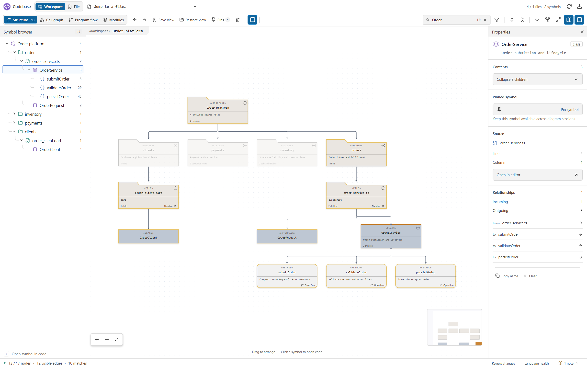
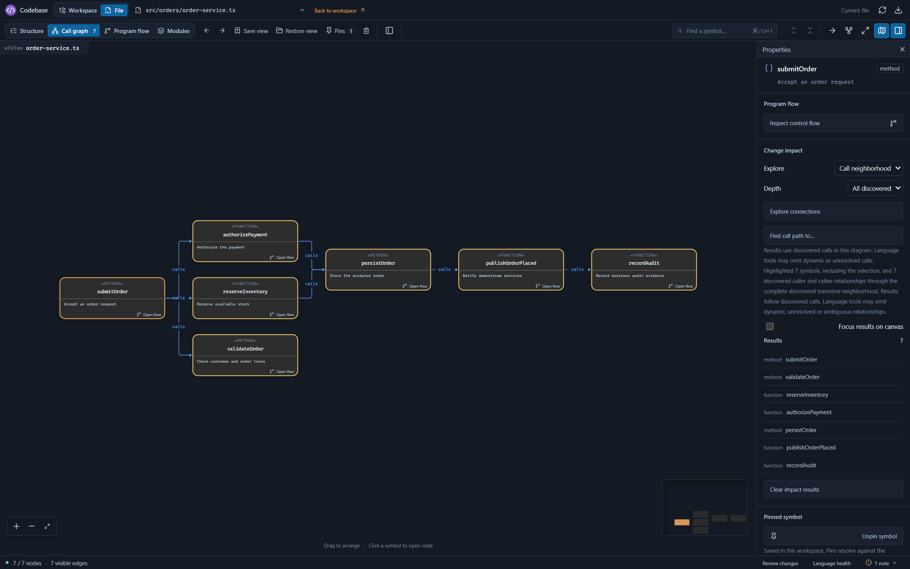
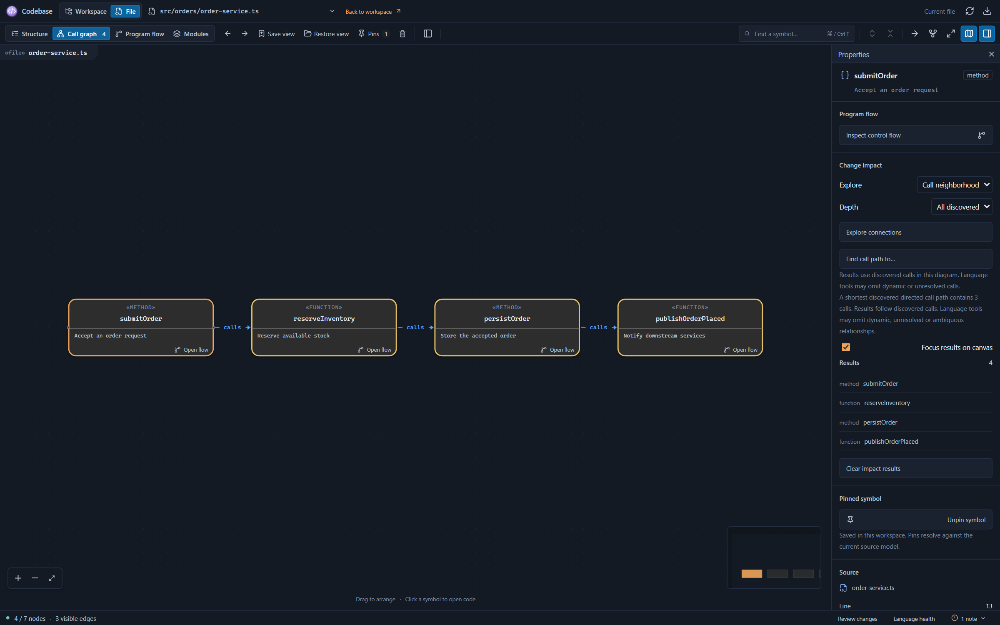
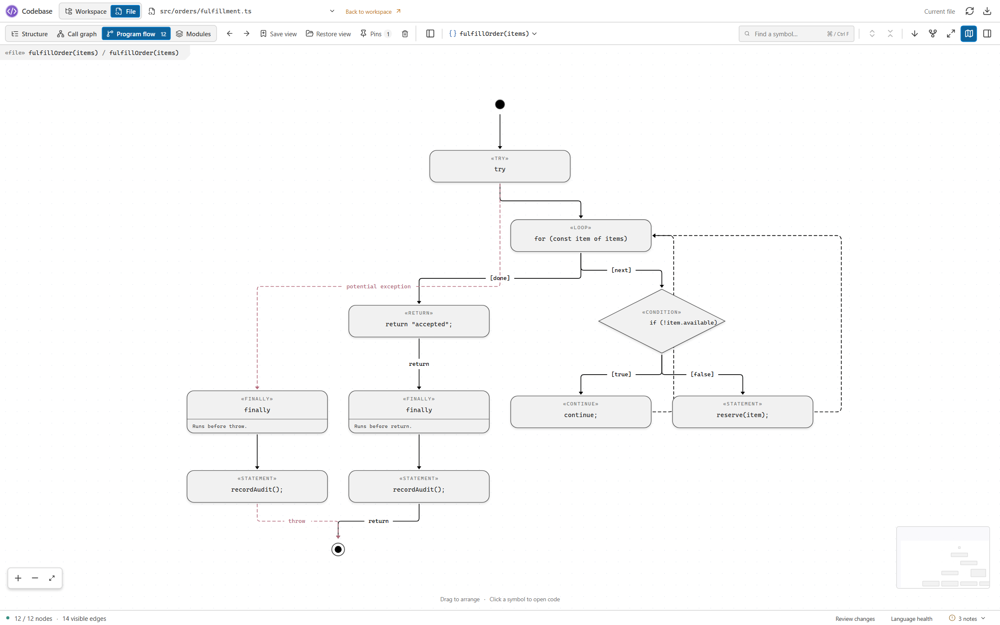
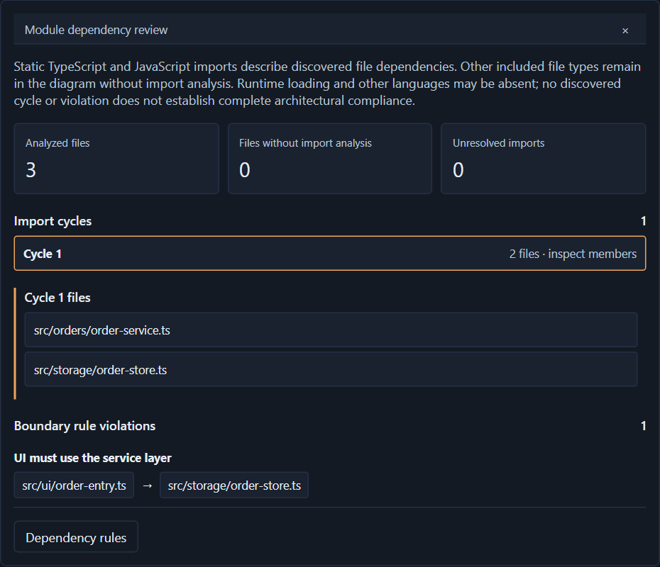
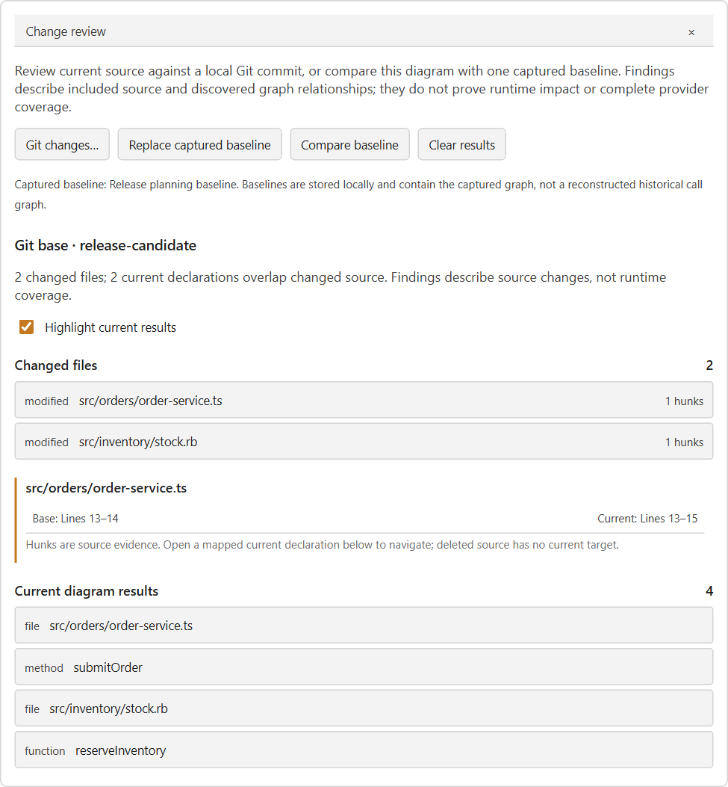
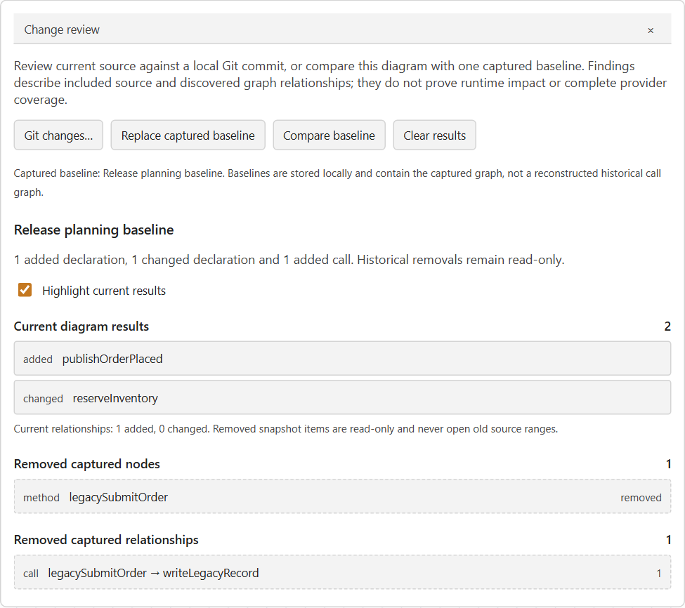
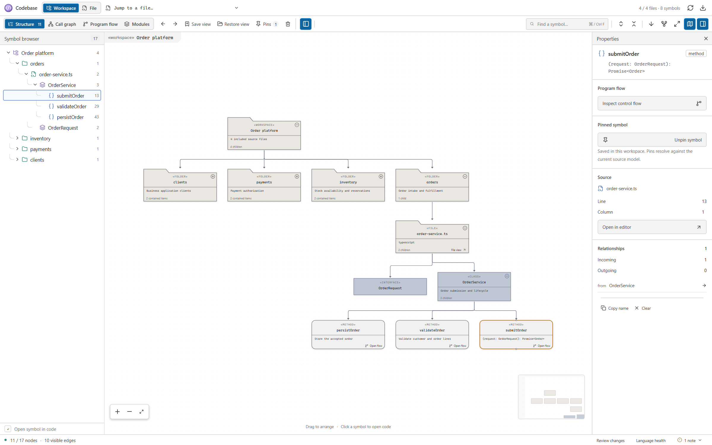
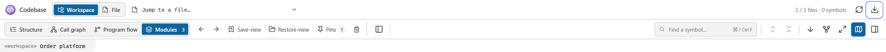
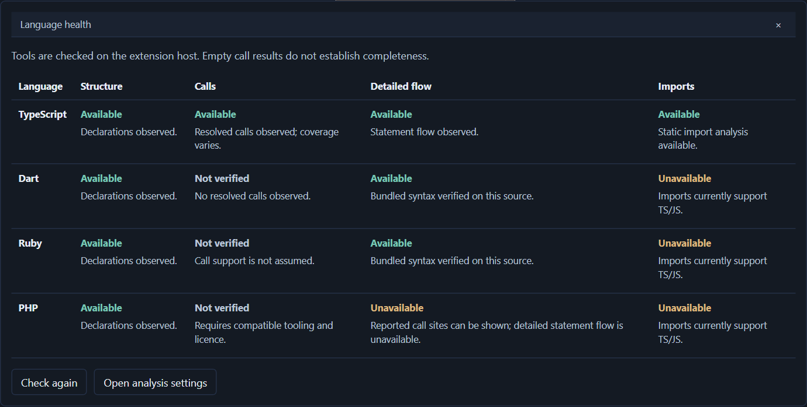

# Codebase user guide

Use Codebase to understand a service, investigate a refactor and review source or dependency changes inside VS Code. Start with a workspace overview, follow a declaration into its file or function, and export the relevant diagram for your team's existing review and documentation process.

This guide covers **Aliot Codebase 0.6.0**.

The images show the current Codebase interface with a fictional **Order platform** sample. All project, source, provider, impact and review data is illustrative. Native VS Code naming, selection and save dialogs are not simulated in these images.

## Install and open your first workspace

Codebase runs in desktop VS Code 1.96 or newer and remote Node extension hosts. Open **Extensions**, search for **Aliot Codebase** by **voidaliot**, and install it.

If you have a VSIX supplied by the publisher, use **Extensions: Install from VSIX…**, or:

```sh
code --install-extension codebase-vsc-ext-0.6.0.vsix
```

Open a folder or multi-root workspace, then:

1. Run **Codebase: Open Workspace Diagrams** from the Command Palette.
2. Choose **Structure** and expand a folder, file or class.
3. Search for a declaration and select it to open its exact source range.
4. Open **Language health** in the bottom bar to inspect the workspace's language capabilities.
5. Read any **notes** beside it before interpreting missing relationships or a limited diagram.

For a single file, run **Codebase: Open Diagrams**, use the editor title diagram icon, or choose a Codebase action from the editor or Explorer context menu. A supported declaration's inline **Show diagram** link opens its own diagram: functions and methods open flow; classes and types open focused structure. The clicked declaration determines the target even when the caret is elsewhere.



*Order platform sample: search the workspace hierarchy, expand relevant folders and select a declaration to inspect its source and relationships.*

## Feature reference

| Feature | Where to use it | Result |
| --- | --- | --- |
| Workspace and file scope | **Workspace / File**, file picker and **Back to workspace** | Move between overview and focused inspection |
| Structure | **Structure** tab | Browse included files and declaration containment |
| Calls and impact | **Call graph**, then a selected symbol's **Properties** | Inspect discovered calls, callers/callees, neighborhoods and paths |
| Function flow | **Program flow**, function picker or **Open flow** | Follow static statement paths or disclosed call-site flow |
| Module dependencies | **Modules** and **Module review** | Inspect static TS/JS imports, cycles and boundary rules |
| Source navigation | Symbol cards, browser, **Open in editor** and result links | Open the exact current target while preserving diagram context |
| Search and focus | Search box and filter button | Find hidden symbols and focus matches with their neighbors |
| Hierarchy controls | Card/browser disclosure buttons and expand/collapse toolbar controls | Change visible detail while retaining the model |
| Canvas arrangement | Drag, zoom, direction, arrange and fit controls | Organize the diagram for the question being investigated |
| Symbol browser and minimap | Toolbar toggles | Navigate hierarchy and large diagrams |
| Properties | Select a symbol and open **Properties** | Inspect source, contents and relationship previews; copy its name |
| Saved views | **Save view**, **Restore view** and delete control | Retain named workspace exploration context |
| Pins and history | **Pin symbol**, **Pins**, back/forward arrows | Return to useful declarations and recent contexts |
| Git review | **Review changes → Git changes…** | Compare current included source and unsaved buffers with a local base |
| Captured baseline | **Capture baseline / Compare baseline** | Compare the current graph with one retained local snapshot |
| Export | Download control or **Codebase: Export Diagram** | Save complete JSON or visible/viewport SVG and PNG |
| Language health | Bottom-bar **Language health** | Inspect separate symbol, call, statement-flow and import capabilities |
| Freshness and cancellation | Refresh/cancel controls and settings | Retry analysis, follow unsaved edits and stop current work |
| Notes and counts | Bottom status bar | Read limitations and distinguish visible objects from the full model |

## Choose a diagram

| View | Workspace scope | File scope |
| --- | --- | --- |
| **Structure** | Roots, folders, files and discovered declarations, including disconnected files | Document symbols, or a focused declaration and its descendants |
| **Call graph** | Calls reported for all discovered callables in included supported sources | A focused call graph using the configured file depth and node limits |
| **Program flow** | A function inventory with targets for detailed drilldown | The selected function's statement flow, or an explained call-site fallback |
| **Modules** | Static TS/JS file imports, cycles and configured boundary violations | Workspace-only: selecting it switches to Workspace; **File** returns to File Structure |

Workspace scope stays on the workspace when you switch editors. File scope normally follows the active supported editor when `codebase.followActiveEditor` is enabled. An intentional source jump keeps the originating diagram and selected function in place.

The inventory includes every file allowed by the exclusion settings across all workspace roots. Unsupported file types remain visible as files. Folders are derived from included files, so empty directories are not displayed. Workspace file limits are optional and disclosed; detailed file diagrams have separate limits.

## Navigate and arrange the diagram

Select a symbol card or browser row to inspect it and open its source. **Properties** shows its source location, children, available flow action and a preview of incoming/outgoing relationships. Use **Open file diagram** on a workspace file, **Inspect control flow** on a callable, or **Copy name** when recording a finding.

Expand one group with its disclosure control, or use **Expand entire hierarchy** and **Collapse entire hierarchy**. Collapsed groups retain hidden descendants; connections can be redirected and combined at visible ancestors. Counts in the bottom bar distinguish visible objects from the complete current model.

Search includes hidden symbols and exposes their hierarchy paths. The filter control **Focus matches and their neighbors** narrows presentation without changing the analyzed model. Clear the search to return to ordinary browsing.

Drag nodes to rearrange them. Use the zoom controls, **Fit diagram to view**, the minimap and **Tree direction** to move between overview and detail. **Arrange nodes automatically** discards the current arrangement for that diagram and computes a new one. Positions and direction are remembered for the diagram context. The symbol browser, properties and minimap can each be hidden from the toolbar.

Large diagrams use a lightweight overview at distant zoom levels and detailed cards when zoomed in. Their full model remains available for search, source targets and complete JSON export.

### Keyboard controls

| Action | Key or control |
| --- | --- |
| Focus diagram search | `Ctrl+F` on Windows/Linux or `Cmd+F` on macOS while the panel has focus |
| Clear search/selection and close open review, health, module or notes panels | `Esc` |
| Activate a focused button or symbol-browser item | Standard `Enter` or `Space` button behavior |
| Expand a browser item | `Right Arrow` on its focused row |
| Collapse a browser item or move to its parent | `Left Arrow` on its focused row |
| Move through controls, selectors and result pages | `Tab` / `Shift+Tab`, then native button/select keys |

## Onboard to a service

Begin in **Workspace Structure** to identify folders, entry points and important types. Search for a domain term such as “Order”, expand its containing hierarchy and inspect the declaration's properties. Open its source before drawing conclusions from its label.

Switch to **Call graph** to follow reported connections, then open **Program flow** for a function whose behavior needs closer inspection. Save a view for the subsystem overview and pin important named declarations for your next session. Export a focused SVG for an onboarding page when the diagram communicates a useful relationship.

## Investigate a refactor

In **Call graph**, select a function or method and open **Properties → Change impact**:

1. Choose **Callers**, **Callees** or **Call neighborhood**.
2. Select **Direct · 1 hop**, **2 hops**, **3 hops** or **All discovered**.
3. Choose **Explore connections** and inspect the paged results.
4. Enable **Focus results on canvas** to emphasize the result while retaining the complete model.
5. Open relevant current symbols, inspect their function flow, and choose **Clear impact results** when finished.



*Order platform sample: explore callers, callees or the complete discovered neighborhood. Result highlights remain separate from the complete diagram.*

For a specific connection, select the starting symbol, choose **Find call path to…** and select a target in VS Code's picker. Codebase finds a shortest discovered directed call path. The path follows call direction; a result in the opposite direction answers a different question.



*Order platform sample: find a directed path and focus its results while retaining the surrounding model. Missing paths do not establish absence.*

Impact results use discovered calls in the current diagram. Dynamic, unresolved or unsupported calls may be absent. “No path found” therefore does not prove that a runtime change is safe. A query that exceeds its budget refuses explicitly; it does not return a clipped result as if it were complete. Use a smaller file diagram when needed.

### Inspect function flow

Use **Open flow**, **Inspect control flow**, an inline **Show diagram** link, or the File **Program flow** function selector. Statement flow can show assignments, branches, loops, selection alternatives, returns, explicit throws and cleanup paths. Nested functions have separate targets.



*Order platform sample: a fulfillment function shows its loop, conditional branch, continue, return and finally cleanup. Statements retain exact source targets.*

Flow is static source analysis. It does not record a program run, resolve every implicit exception or model all scheduling and dynamic dispatch. Unsupported constructs and approximations appear in notes. When detailed syntax is unavailable, **call-site flow** can list provider-reported calls in source order with separate callee links; that order is not an execution guarantee. PHP currently uses this provider tier without detailed statement flow.

## Review module boundaries

Choose **Modules**, then **Module review** in the bottom bar. The diagram retains included files while static import analysis currently covers TypeScript and JavaScript. Review the counts of analyzed files, unsupported files and unresolved imports before interpreting the findings.

Select an import cycle to inspect its members. A cycle means the discovered resolved imports connect those files back to one another; it does not by itself establish a runtime failure. Findings and member lists have pages so larger results remain accessible.



*Order platform sample: review static TS/JS imports, inspect cycle members and locate a configured boundary-rule violation.*

Choose **Dependency rules** to open the setting. Rules describe forbidden imports between paths relative to their workspace folder. For example, require UI code to use a service layer instead of importing storage directly:

```json
{
  "codebase.dependencyRules": [
    {
      "name": "UI must use the service layer",
      "from": "src/ui/**",
      "to": "src/storage/**"
    }
  ]
}
```

Refresh the Modules view after changing the setting. A violation links the importing and imported current files. Globs support `**` across path segments, `*` within a segment and `?` for one character. Up to 100 rules are accepted; names have a 120-character limit and each pattern a 1,024-character limit.

Rules apply to resolved imports between included files. External boundaries, unresolved aliases, unsupported configuration and other languages remain disclosed. Findings describe the inspected evidence and do not certify complete architecture compliance.

## Review source changes with Git

Git review compares current text, including unsaved buffers, with an existing local commit or ref. It requires a trusted filesystem workspace and installed **Git 2.45 or newer** on the extension host, outside the analyzed workspace. It does not fetch objects, check out files or modify the Git index.

1. Refresh the diagram so it reflects the current source.
2. Open **Review changes** in the bottom bar and choose **Git changes…**.
3. Select a workspace folder if prompted, then enter a local base such as `HEAD` or another available commit/ref.
4. Inspect changed files and their base/current line spans. Select a file to page through its hunks.
5. Enable **Highlight current results**, then open a mapped current declaration from the results.



*Order platform sample: compare current and unsaved source with a local Git commit, inspect changed line spans and open mapped current declarations.*

In **Workspace** scope, review uses the included file nodes in the current diagram. In **File** scope, it covers only the current source file, even if the call graph shows callees in other files. Historical deleted or excluded paths outside that inventory are unknown; this is not a complete repository status or historical analysis. Full current declaration ranges help associate edits inside a body with that declaration. Hunks describe line changes, with physical newline styles and a UTF-8 BOM normalized.

Skipped files show their reason, including unsupported text or review limits. Textual overlap is change evidence, not proof of runtime impact. Source, file or configuration changes invalidate review even with automatic refresh disabled; refresh before reviewing again. **Cancel review** stops pending review work; **Clear results** removes the overlay.

## Compare a captured diagram baseline

A captured baseline is one locally retained graph from an earlier point in your investigation. It is useful for comparing discovered declarations and relationships before and after a change.

1. Open the diagram context you want to retain and choose **Review changes → Capture baseline**.
2. Make your source changes and refresh the diagram.
3. Return to a compatible view, scope, workspace roots, file and selected function where applicable.
4. Choose **Compare baseline** and inspect current additions/changes plus removed captured items.



*Order platform sample: compare with a retained local baseline. Added and changed current items can be opened; removed captured items remain read-only.*

Comparison matches unique declaration identities across line movement. It reports added/removed nodes and added, removed or count-changed relationships. Generated or ambiguous items remain uncompared instead of being matched by old line numbers. Renames, moves or changed declarations may no longer reconcile.

This compares the graph you actually captured; it does not reanalyze a Git commit or reconstruct historical calls. Use Git review for textual body changes. Removed captured objects have no source-navigation action. **Replace captured baseline** explicitly overwrites the workspace's one baseline; **Clear results** retains it. Incompatible or oversized captures/comparisons fail explicitly while preserving the current diagram.

## Save views and pin symbols

**Save view** records the scope, diagram kind, file/function or focused structure context, expansion, direction, viewport, positions, search, match filter and selected symbol when it can be reconciled. Enter a name in the native VS Code dialog; reusing a name replaces that view. Use **Restore view** to select it later and the delete control to remove one.



*Order platform sample: save and restore a diagram, navigate exploration history and pin a named symbol for a later session. Native naming and selection dialogs are outside this image.*

In **Properties**, choose **Pin symbol** or **Unpin symbol**. **Pins** opens the workspace's bookmarks and also offers removal. A pin opens source only after resolving uniquely in the current model. Missing or ambiguous matches remain visible; generated or unnamed items may have no persistent identity.

Back/forward arrows navigate diagram exploration history for the session. Restoring a view or history context does not intentionally jump the source editor; choosing a matched pin does. Saved identities reconcile current declarations rather than reusing old source coordinates.

The local workspace library supports **20 named views and 100 pins within 2 MiB**, with up to **5,000 saved positions per view**. Session history retains up to **30 entries within a separate 2 MiB budget**. Oversized saves are refused explicitly; collapse unneeded groups, reset positions with **Arrange nodes automatically**, or remove unused views/pins before retrying. Unreconciled presentation targets are reported rather than guessed.

These features are local workspace state, not cloud synchronization or a shared team workspace. Use exported diagrams to share a finding.

## Export for reviews and documentation

Choose the top-right download control or run **Codebase: Export Diagram**. A native VS Code picker offers:

| Choice | What is saved |
| --- | --- |
| **Complete model · JSON** | Every node and relationship in the current analyzed model, including collapsed or presentation-hidden descendants |
| **Visible diagram · SVG** | The entire visible projection, including parts outside the screen |
| **Current viewport · SVG** | The diagram at the current pan and zoom, cropped to the viewport |
| **Visible diagram · PNG** | An image of the entire visible projection |
| **Current viewport · PNG** | An image cropped to the current diagram viewport |

Then choose a destination in VS Code's save dialog. Image export captures the diagram, not its surrounding toolbars, properties or review panels. Expand groups first if their descendants should appear in an image. JSON retains the full current model even when a presentation filter or collapsed group hides objects; configured analysis limits and provider gaps still apply.



*Order platform sample: the top-right download control opens native format/scope and save pickers. Only the real webview control is pictured here.*

SVG is self-contained and suitable for scalable documentation. PNG is limited to 8,192 pixels per side, 16 million pixels and 24 MiB. An oversized image is refused with guidance; use SVG/JSON or a smaller visible scope instead of expecting silent clipping. Exports include the diagram's labels and, in JSON, source locations. Share the chosen file through your organization's usual channels.

## Check language health

Open **Language health** in the bottom bar. Structure, calls, detailed statement flow and imports have independent states:

| State | Meaning |
| --- | --- |
| **Available** | The capability is available on the reported evidence; read its explanation for what was checked and any coverage limits |
| **Unavailable** | A prerequisite or supported capability is absent, with relevant guidance |
| **Not verified** | The capability has not been exercised successfully or the evidence is inconclusive |
| **Failed** | A capability check or analysis failed; inspect its explanation and retry |

Use **Check again** to inspect tools without moving the diagram, or **Open analysis settings** to configure prerequisites. After a provider finishes project indexing, refresh the diagram to retry its analysis. Empty calls alone prove neither that every call was resolved nor that the provider is absent.



*Illustrative language-health states: Dart and Ruby syntax can be available while calls remain unverified; PHP reports its detailed-flow limit.*

### Language matrix

Structure and calls use installed public VS Code providers when available. Statement syntax is a separate capability; Modules import analysis currently supports TS/JS only.

| Language | Typical provider for symbols and available calls | Detailed statement flow |
| --- | --- | --- |
| TypeScript / JavaScript | Built-in TypeScript and JavaScript Language Features | Included official compiler syntax |
| Python | Pylance or basedpyright | Trusted CPython 3.10+ |
| Java | Red Hat Java | Trusted full JDK 21+ |
| Kotlin | Kotlin by JetBrains | Trusted standalone Kotlin SDK, tested with 2.2.21, and JDK 21+ |
| C | clangd or Microsoft C/C++ | Active clangd with supported AST capability |
| C++ | clangd or Microsoft C/C++ | Active clangd with supported AST capability |
| Rust | rust-analyzer | Supported rust-analyzer syntax-tree schema |
| C# | C# language extension | Trusted .NET SDK 8+ with Roslyn |
| Go | Go with gopls | Trusted Go SDK 1.23+ |
| Dart | Dart language extension | Included official analyzer; no end-user Dart SDK |
| PHP | PHP Tools or another compatible public provider | Unavailable; provider call-site flow when available |
| Ruby | Ruby LSP or Solargraph for available symbols; call hierarchy is separate | Included official Prism parser; no end-user Ruby runtime |

Ruby LSP/Solargraph installation does not promise call-hierarchy support. Microsoft C/C++ alone does not provide Codebase's detailed statement AST. The file must have the correct VS Code language mode. See [language setup](languages.md) for exact suffixes, provider IDs and construct-specific behavior.

Optional external syntax helpers require a trusted workspace and trusted installed tools on the extension host. For SSH, WSL or containers, use the remote host's tools and machine settings. Bundled TypeScript/JavaScript, Dart and Ruby syntax does not require those external helpers; pure Dart/Ruby parsing is available in untrusted workspaces.

## Commands

Every command below has the **Codebase:** prefix in the Command Palette.

| Command | Purpose |
| --- | --- |
| **Open Workspace Diagrams** | Open the workspace overview in the current/default view |
| **Open Diagrams** (editor toolbar and Explorer) | Open a supported file's diagram |
| **Show Workspace Structure** | Open Workspace Structure |
| **Show Workspace Call Graph** | Open the workspace call graph |
| **Browse Workspace Program Flow** | Open the workspace function inventory |
| **Show Module Dependencies** | Open workspace Modules |
| **Open Diagrams** (automatic scope) | Use workspace scope when a workspace is open, otherwise file scope |
| **Show Structure** | Open File Structure |
| **Show Call Graph** | Open a file call graph |
| **Show Program Flow** | Open file/function flow |
| **Refresh Diagrams** | Retry the current diagram's analysis |
| **Export Diagram** | Choose the current model/image export format and destination |

Saved views, pins, impact, review and language-health actions are controls inside the diagram panel. **Show diagram** is the inline declaration action.

## Settings

Open VS Code Settings and search for `Codebase`, or edit the applicable settings JSON.

| Setting | Default | Effect |
| --- | --- | --- |
| `codebase.codeLens.enabled` | `true` | Show inline **Show diagram** links; VS Code's `editor.codeLens` must also permit them |
| `codebase.analysis.statementFlow` | `true` | Prefer official detailed syntax for additional languages; disable to inspect provider call-site flow |
| `codebase.followActiveEditor` | `true` | Follow supported active editors in File scope |
| `codebase.autoRefresh` | `true` | Refresh after edits, including unsaved changes |
| `codebase.maxNodes` | `180` | Detailed file diagram node limit; allowed range 20–1,000 |
| `codebase.graphDepth` | `2` | File call-graph depth; allowed range 1–4; workspace calls have no corresponding depth cutoff |
| `codebase.exclude` | Dependency/generated folders listed below | Additional workspace exclusion globs |
| `codebase.maxWorkspaceFiles` | `0` | No file cap at zero; a positive cap discloses an incomplete inventory |
| `codebase.dependencyRules` | `[]` | Forbidden import boundaries in workspace Modules; see the rule example above |

The default `codebase.exclude` patterns exclude `node_modules`, `.git`, `dist`, `build`, `coverage`, `.next`, `out`, `.vscode-test`, `.dart_tool` and `.temp` directories at any depth. VS Code's `files.exclude` and `search.exclude` also apply. Adjust all relevant settings when intentionally including generated sources or dependencies.

These five optional tool settings are **machine-scoped**, default to an empty string and belong on the extension host:

| Setting | Value when configured | Discovery when empty |
| --- | --- | --- |
| `codebase.analysis.pythonPath` | Absolute CPython 3.10+ executable | Host `PATH` |
| `codebase.analysis.javaPath` | Absolute full JDK 21+ `java` executable with sibling `javac` | `JAVA_HOME` or `PATH` |
| `codebase.analysis.kotlinHome` | Absolute standalone Kotlin SDK directory containing `lib/kotlin-compiler.jar` | `KOTLIN_HOME` |
| `codebase.analysis.goPath` | Absolute Go SDK executable | Host `PATH` |
| `codebase.analysis.dotnetPath` | Absolute .NET SDK 8+ `dotnet` executable | Host `PATH` |

There is no end-user Dart/Ruby syntax SDK setting, and no PHP detailed-statement backend to configure. `codebase.codeLens.enabled` and `codebase.analysis.statementFlow` can be set per resource; dependency rules apply at window/workspace level. Detailed setup is in [language support](languages.md).

## Refresh and troubleshoot

The top refresh control or **Refresh Diagrams** retries the current analysis. Automatic refresh follows edits when enabled, including unsaved buffers. Indexing progress appears in the panel; **Cancel analysis** stops current work. The status bar shows visible/total nodes, visible edges, search matches and analysis timing where available. Timings describe that analysis, not a performance guarantee.

| Symptom | Next step |
| --- | --- |
| A file or folder is missing | Check all three exclusion settings and any workspace file cap; empty folders are not listed |
| A supported file opens as Plain Text | Install/enable its language support and choose the correct VS Code language mode |
| Structure or calls are missing | Check **Language health**, let the provider finish project setup/indexing, then refresh |
| Detailed flow is unavailable | Check that language's syntax prerequisites and workspace trust; PHP intentionally has call-site flow only |
| Calls are empty or no path is found | Treat the result as inconclusive about runtime behavior; inspect provider coverage and source |
| Review says the diagram is stale | Refresh after source/files/configuration changed, even if automatic refresh is disabled |
| A baseline is incompatible | Return to the same view/scope/workspace/file/function context, or explicitly replace it |
| A saved view or pin is missing/ambiguous | Refresh the relevant context; renamed/moved/changed declarations may need a new view or pin |
| A save, query, syntax parse or image exceeds a limit | Read the refusal, narrow the relevant scope or simplify the presentation; the active graph is retained |
| Arrangement or analysis failed | Read the panel message and notes, then retry after resolving the reported prerequisite |

## Local data and team use

Analysis runs on the extension host; layout runs in the bundled local worker. Codebase makes no external network requests or source uploads during analysis and layout. It does not execute the analyzed program, restore its packages or modify/save its source. Deliberate source navigation opens the current range; explicit export writes the file you choose. Saved views, pins and the captured baseline remain in workspace-local extension storage.

Use named views for your own repeated investigations, Git/baseline findings as supporting review evidence, and exported diagrams in your organization's existing documents. Codebase supplies static evidence and navigation; engineering review still determines whether a proposed change is correct.

For help, see [Support](../SUPPORT.md) or report an issue in the [public repository](https://github.com/voidaliot/codebase/issues). Desktop and remote Node hosts are supported; a browser extension host for vscode.dev is not provided.
